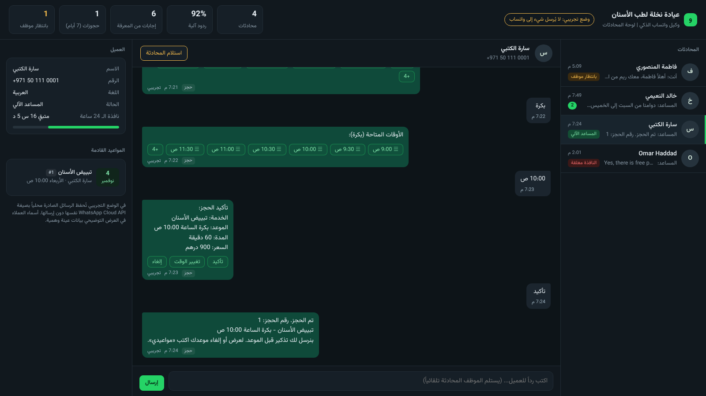
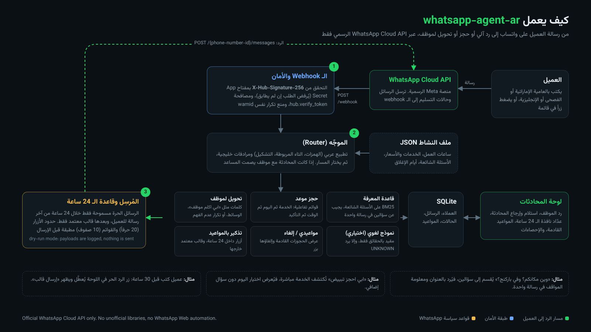

**English** | [العربية](README.md)

# whatsapp-agent-ar: Arabic AI agent on the official WhatsApp Cloud API

**An open-source WhatsApp assistant for small businesses in the UAE. It answers in Gulf Arabic, MSA and English, books appointments with interactive lists, hands chats to a human when needed, and gives the team a conversation dashboard.**

[](https://github.com/mohammadhadijavidi/whatsapp-agent-ar/actions/workflows/ci.yml)
[](LICENSE)
[](pyproject.toml)
[](pyproject.toml)
[-25D366.svg)](https://developers.facebook.com/docs/whatsapp/cloud-api)



<sub>Real screenshot of the dashboard running in dry-run mode. The clinic and customers are fictional sample data and the customer messages are hand-written. Every bot reply, booking and handoff shown was produced by the actual code.</sub>

## Why

Clinics, salons and service shops in Dubai and Abu Dhabi get dozens of WhatsApp messages a day: "how much is cleaning?", "where are you?", "can I book tomorrow?". Most "WhatsApp bot" options fall into one of three groups:

- **WhatsApp Web automation or unofficial libraries.** Numbers get banned, and they break Meta's terms.
- **Closed subscription platforms.** They don't understand Emirati Arabic ("شو", "وين", "ابي", "الدختر", "الموتر").
- **LLM-only chatbots.** They make up prices and time slots that don't exist.

**whatsapp-agent-ar** runs only on the **official WhatsApp Cloud API**, and the code enforces its rules: webhook signatures, the 24-hour customer service window, approved templates, and button and list limits. It answers from a **knowledge base you write**, so it needs no API key. An LLM is optional, and when you add one it may only answer from your business facts.

**How it differs:** there are good English Cloud API bot samples and commercial inbox platforms. This project fits into one small, dependency-free package:

- Gulf-dialect understanding
- a complete booking flow with double-booking protection
- human handoff with an Arabic RTL dashboard that shows a 24-hour window countdown
- template-based reminders

## Features

- **Official WhatsApp Cloud API only.**
  - Handles the `hub.verify_token` handshake.
  - Checks **`X-Hub-Signature-256`** (HMAC-SHA256 of the raw body with your App Secret) with a constant-time comparison. Unsigned requests are rejected.
  - De-duplicates by `wamid`, so retried webhooks are processed once.
- **The 24-hour rule is enforced in code.** Free-form messages go out only within 24 hours of the customer's last message. After that, the agent and the dashboard block them and offer "send template" instead. Known Meta errors such as `131047` come with a plain explanation.
- **Arabic and Gulf dialect understanding.**
  - Normalizes hamza, taa marbuta, diacritics, tatweel and Arabic-Indic digits.
  - Uses a hand-written Gulf synonym map: وين → location, بكم → price, يعورني → pain, الموتر → parking.
  - Answers two questions in one message ("وين مكانكم؟ وفي باركنج؟").
- **Knowledge-base answers with no API key.** BM25 search over your FAQ. It never guesses: with no confident match it shows the menu, and after two misses it offers a human.
- **Appointment booking with interactive lists.**
  - The customer picks a service, then a day ("اليوم", "بكرة", "الأحد 8/11"), then a time, then confirms.
  - Respects split shifts, closed dates, service duration and minimum notice.
  - Prevents double booking when two customers pick the same slot.
- **"My appointments", cancel with one tap, and reminders.** Reminders are interactive buttons inside the 24-hour window and an **approved template** outside it.
- **Human handoff.** Triggered when the customer:
  - writes something like "I want to talk to someone" or "complaint"
  - sends media (image, voice note)
  - hits repeated misses

  The bot then stays silent until staff hand the chat back.
- **Arabic RTL staff dashboard**, password protected:
  - conversation list
  - the source of each reply (knowledge base, booking, handoff, staff)
  - staff replies, and take-over/release
  - 24-hour window countdown, upcoming appointments and stats
- **Bilingual.** Detects the customer's language and replies in Arabic or English.
- **Optional, grounded LLM fallback.** Works with OpenAI, OpenRouter, Groq, Ollama, LM Studio and Anthropic. It runs only when the FAQ has no match, and must answer from your facts or return `UNKNOWN`.
- **Dry-run mode.** Try everything locally without a Meta account. Outgoing messages are stored in the exact Cloud API payload format.
- **Zero runtime dependencies.** Standard library, SQLite, a WSGI app that runs under gunicorn, and a ready Dockerfile.

## Quick start

```bash
pip install git+https://github.com/mohammadhadijavidi/whatsapp-agent-ar
```

**1) Chat with the agent in your terminal** (no account or key needed):

```bash
whatsapp-agent-ar chat
```

```text
> How much is whitening?
Prices: check-up AED 150, cleaning & polish AED 250, ... whitening AED 900 ...
> ابي احجز تبييض
تمام، تبييض الأسنان. اختر اليوم المناسب:
   1. اليوم    (#day:2026-11-04)
   2. بكرة    (#day:2026-11-05)
```

Type an option's number to tap that button or list row. Add `--json` to see the exact payload that would be sent to Meta.

**2) Run the dashboard with sample conversations:**

```bash
whatsapp-agent-ar serve --demo --port 8000
# open http://127.0.0.1:8000
```

**3) Connect a real WhatsApp number:**

```bash
git clone https://github.com/mohammadhadijavidi/whatsapp-agent-ar && cd whatsapp-agent-ar
cp .env.example .env      # fill in values from Meta for Developers
docker compose up -d      # or: pip install -e ".[prod]" && gunicorn 'whatsapp_agent_ar.server:create_app()' -b 0.0.0.0:8000
whatsapp-agent-ar check   # validates your configuration
```

Then in Meta for Developers, open your app and go to WhatsApp, then Configuration:

1. **Callback URL**: `https://your-domain/webhook` (must be HTTPS).
2. **Verify token**: the same value as `WHATSAPP_VERIFY_TOKEN`.
3. Subscribe to the **messages** field.
4. Put the **App Secret** in `WHATSAPP_APP_SECRET`. Without it, every webhook POST is rejected on purpose.
5. Create the `appointment_reminder` template and submit it for approval (see [examples/templates.md](examples/templates.md)).

## Configuration

| Variable | Description |
|---|---|
| `WHATSAPP_ACCESS_TOKEN` | Permanent System User token with `whatsapp_business_messaging` |
| `WHATSAPP_PHONE_NUMBER_ID` | Phone number ID from the API Setup page |
| `WHATSAPP_VERIFY_TOKEN` | Random string you choose for the verification handshake |
| `WHATSAPP_APP_SECRET` | Used to verify `X-Hub-Signature-256` (required) |
| `WHATSAPP_GRAPH_VERSION` | Graph API version (default `v23.0`) |
| `WA_DRY_RUN` | `1` = never call Meta (default when no token is set) |
| `WA_BUSINESS_FILE` | Your business JSON: hours, services, prices, FAQ |
| `WA_REMINDER_TEMPLATE` / `_LANG` | Approved reminder template name and language |
| `DASHBOARD_USER` / `DASHBOARD_PASSWORD` | HTTP Basic auth for the dashboard |

**LLM providers (optional):**

| `WA_LLM_PROVIDER` | Key | Notes |
|---|---|---|
| `mock` (default) | none | Generates nothing: always returns `UNKNOWN`, so only deterministic logic runs |
| `openai` | `WA_LLM_API_KEY` or `OPENAI_API_KEY` | e.g. `WA_LLM_MODEL=gpt-4o-mini` |
| `openrouter` | `WA_LLM_API_KEY` | Any OpenRouter model |
| `groq` | `WA_LLM_API_KEY` | Fast and cheap |
| `ollama` / `lmstudio` | none | Local model, override with `WA_LLM_BASE_URL` |
| `anthropic` | `ANTHROPIC_API_KEY` | e.g. `WA_LLM_MODEL=claude-sonnet-4-5` |

## Usage examples

**Business file.** [examples/clinic/business.json](examples/clinic/business.json) is a sample for a fictional dental clinic:

```json
{
  "name": "عيادة نخلة لطب الأسنان",
  "hours": { "fri": ["16:00-21:00"], "sat": ["09:00-13:00", "16:00-21:00"] },
  "services": [{ "id": "cleaning", "name": "تنظيف وتلميع", "name_en": "Cleaning & polish", "minutes": 45, "price": 250 }],
  "handoff_keywords": ["موظف", "شكوى", "human"],
  "faq": [{ "id": "parking", "questions": ["في مواقف؟", "Is there parking?"], "answer": "...", "answer_en": "..." }]
}
```

**As a Python library** ([examples/python_api.py](examples/python_api.py)):

```python
from whatsapp_agent_ar import Agent, Business, Store
from whatsapp_agent_ar.providers import Mock
from whatsapp_agent_ar.whatsapp import WhatsAppClient

agent = Agent(Business.load("examples/clinic/business.json"), Store("bot.db"), WhatsAppClient(dry_run=True), Mock())
agent.handle_webhook(payload_from_meta)   # handles messages and delivery statuses
```

**Send a signed webhook locally**, exactly as Meta does:

```bash
whatsapp-agent-ar sign examples/sample_webhook.json --secret "$WHATSAPP_APP_SECRET"
curl -X POST http://127.0.0.1:8000/webhook -H "X-Hub-Signature-256: sha256=..." --data-binary @examples/sample_webhook.json
```

**Appointment reminders** (run from cron every hour):

```bash
whatsapp-agent-ar reminders --hours 24
```

**Dashboard JSON API:**

- `GET /api/conversations`
- `POST /api/conversations/<wa_id>/reply` (returns `409 outside_24h_window` after 24 hours)
- `POST /api/conversations/<wa_id>/template`
- `POST /api/conversations/<wa_id>/handoff`

## How it works



1. Meta posts to `POST /webhook`. The signature is verified on the **raw bytes** before anything is parsed, and any `wamid` already processed is ignored.
2. The router normalizes the Arabic text and picks a route, checking in this order:
   1. a button or list reply
   2. media (handoff)
   3. a staff request
   4. "my appointments"
   5. booking
   6. the knowledge base
   7. the optional LLM
   8. if nothing matched, the menu or a handoff offer
3. The sender checks the 24-hour window and Meta's limits: button titles up to 20 characters, list rows up to 24 characters, at most 10 rows. It then calls `POST /{phone-number-id}/messages`, or in dry-run mode only stores the payload.
4. Messages, delivery statuses (`sent`, `delivered`, `read`, `failed`) and appointments are stored in SQLite and shown in the dashboard.

## Roadmap

- [ ] Google / Outlook calendar backend for appointments
- [ ] Arabic voice-note transcription (Whisper) before routing
- [ ] WhatsApp Flows for booking forms
- [ ] Multiple staff members with chat assignment
- [ ] Conversation export and appointments CSV
- [ ] Ready-made business profiles: salon, restaurant, real-estate office

## Contributing

Contributions in Arabic or English are welcome. See [CONTRIBUTING.md](CONTRIBUTING.md), and run `pytest -q` before opening a pull request.

## License

MIT, see [LICENSE](LICENSE). The bundled Vazirmatn font is licensed under SIL OFL 1.1.

> This project is not affiliated with or endorsed by Meta. WhatsApp is a trademark of Meta Platforms. Using it is subject to the WhatsApp Business policies, including getting customer opt-in before you message them.

---

Built by [Mohammad Hadi Javidi](https://github.com/mohammadhadijavidi) — AI products & automation, Dubai.
