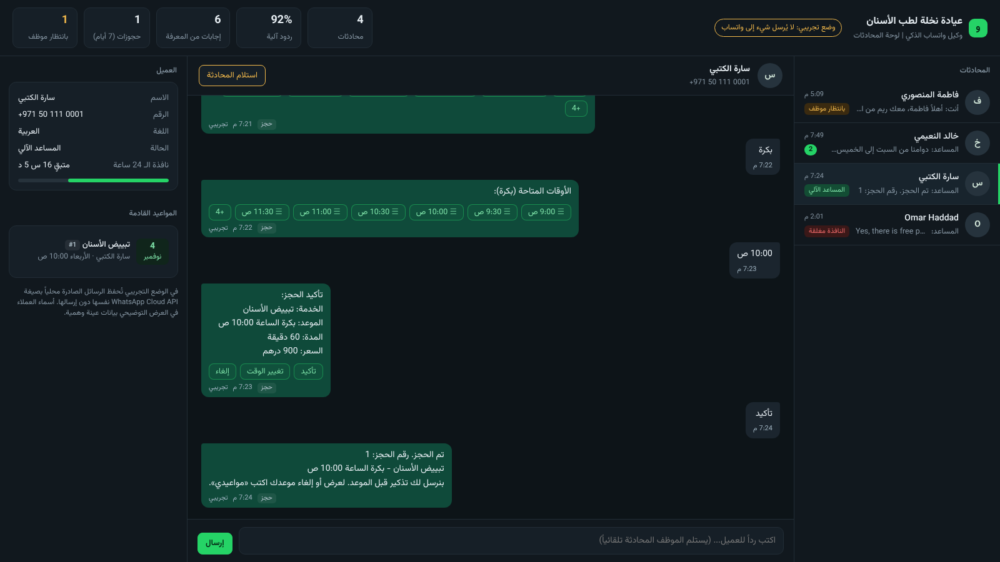
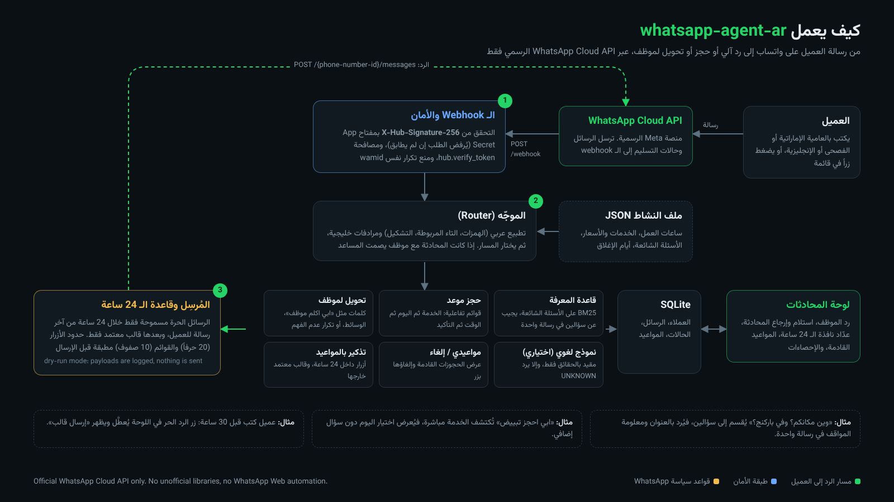

<div dir="rtl">

[English](README.en.md) | **العربية**

# whatsapp-agent-ar: وكيل ذكاء اصطناعي عربي على WhatsApp Cloud API الرسمي

**مساعد واتساب للمشاريع الصغيرة في الإمارات يرد بالعامية الخليجية والفصحى والإنجليزية، ويحجز المواعيد بقوائم تفاعلية، ويحوّل المحادثة لموظف عند الحاجة، مع لوحة محادثات للفريق.**

[](https://github.com/mohammadhadijavidi/whatsapp-agent-ar/actions/workflows/ci.yml)
[](LICENSE)
[](pyproject.toml)
[](pyproject.toml)
[-25D366.svg)](https://developers.facebook.com/docs/whatsapp/cloud-api)



<sub>لقطة حقيقية من لوحة المحادثات تعمل في الوضع التجريبي (dry-run). العيادة والعملاء بيانات عينة وهمية، ورسائل العملاء مكتوبة يدوياً، أما كل ردود المساعد والحجز والتحويل فناتجة عن الكود الفعلي.</sub>

## لماذا whatsapp-agent-ar؟

العيادات والصالونات ومراكز الخدمة في دبي وأبوظبي تستقبل عشرات الرسائل يومياً على واتساب: «بكم التنظيف؟»، «وين مكانكم؟»، «ابي موعد بكرة». معظم أدوات «بوت واتساب» إما:

- مبنية على **أتمتة واتساب ويب أو مكتبات غير رسمية**، فتُحظر الأرقام وتخالف شروط Meta.
- أو **منصات اشتراك مغلقة** لا تفهم العامية الإماراتية («شو»، «وين»، «ابي»، «الدختر»، «الموتر»).
- أو **روبوت محادثة يرسل كل شيء لنموذج لغوي** فيخترع أسعاراً ومواعيد غير موجودة.

**whatsapp-agent-ar** مشروع مفتوح المصدر يعمل فقط على **WhatsApp Cloud API الرسمي**، ويطبّق قواعده فعلياً في الكود (توقيع الـ webhook، ونافذة الـ 24 ساعة، والقوالب المعتمدة، وحدود الأزرار والقوائم)، ويجيب من **قاعدة معرفة تكتبها أنت** دون الحاجة إلى أي مفتاح API. النموذج اللغوي اختياري ومقيّد بحقائق نشاطك فقط.

**ما الذي يميّزه عن المشاريع الموجودة؟** توجد أمثلة جيدة لبوتات WhatsApp Cloud API بالإنجليزية، ومنصات تجارية لإدارة المحادثات. هذا المشروع يجمع في حزمة واحدة صغيرة بلا اعتماديات: فهم العامية الخليجية، وتدفق حجز كامل مع منع الحجز المزدوج، وتحويل لموظف مع لوحة RTL عربية تعرض عدّاد نافذة الـ 24 ساعة، والتذكير بالقوالب المعتمدة.

## المزايا

- **WhatsApp Cloud API الرسمي فقط**: مصافحة التحقق `hub.verify_token`، والتحقق من **`X-Hub-Signature-256`** بمفتاح App Secret بمقارنة ثابتة الزمن (يُرفض أي طلب غير موقّع)، ومنع معالجة الرسالة مرتين عند إعادة Meta إرسال الـ webhook.
- **قاعدة الـ 24 ساعة مطبّقة في الكود**: الرسائل الحرة تُرسل فقط خلال 24 ساعة من آخر رسالة للعميل. بعدها يمنع المساعد واللوحة الإرسال ويعرضان «إرسال قالب» بدلاً منه، وتُشرح أخطاء Meta المعروفة مثل `131047`.
- **فهم العربية والعامية الإماراتية**: تطبيع الهمزات والتاء المربوطة والتشكيل والتطويل والأرقام العربية، ومعجم مرادفات خليجية مكتوب يدوياً (وين ← الموقع، بكم ← السعر، يعورني ← ألم، الموتر ← موقف)، ويجيب عن سؤالين في رسالة واحدة («وين مكانكم؟ وفي باركنج؟»).
- **إجابات من قاعدة معرفة دون مفتاح API**: بحث BM25 على أسئلتك الشائعة، ولا يخمّن: إذا لم يجد تطابقاً واثقاً يعرض القائمة، وبعد محاولتين يعرض التحويل لموظف.
- **حجز مواعيد بالقوائم التفاعلية**: الخدمة ثم اليوم («اليوم»، «بكرة»، «الأحد 8/11») ثم الوقت ثم التأكيد. يحترم ساعات العمل وفترتي الدوام وأيام الإغلاق ومدة كل خدمة والحد الأدنى للإشعار، ويمنع الحجز المزدوج إذا اختار عميلان الوقت نفسه.
- **«مواعيدي» والإلغاء بزر**، والتذكير قبل الموعد: أزرار تفاعلية داخل نافذة الـ 24 ساعة، و**قالب معتمد** خارجها.
- **تحويل لموظف**: عند كلمات مثل «ابي اكلم موظف» أو «شكوى»، أو عند إرسال صورة أو رسالة صوتية، أو بعد تكرار عدم الفهم. بعدها يصمت المساعد حتى يعيد الموظف المحادثة إليه.
- **لوحة محادثات عربية RTL**: قائمة المحادثات، ومصدر كل رد (قاعدة المعرفة، حجز، تحويل، موظف)، ورد الموظف، واستلام المحادثة وإرجاعها، وعدّاد نافذة الـ 24 ساعة، والمواعيد القادمة، والإحصاءات. محمية بكلمة مرور.
- **ثنائي اللغة تلقائياً**: يكتشف لغة العميل ويرد بالعربية أو الإنجليزية.
- **نموذج لغوي اختياري ومقيّد**: OpenAI و OpenRouter و Groq و Ollama و LM Studio و Anthropic، يُستخدم فقط عندما لا تجد قاعدة المعرفة إجابة، ويُطلب منه الإجابة من حقائقك فقط أو الرد `UNKNOWN`.
- **وضع تجريبي (dry-run)**: جرّب كل شيء محلياً دون حساب Meta. تُحفظ الرسائل الصادرة بصيغة Cloud API نفسها.
- **بلا اعتماديات خارجية**: مكتبة Python القياسية فقط، و SQLite، وخادم WSGI يعمل مع gunicorn، و Docker جاهز.

## البدء السريع

```bash
pip install git+https://github.com/mohammadhadijavidi/whatsapp-agent-ar
```

**1) تحدّث مع المساعد في الطرفية** (لا يحتاج أي حساب أو مفتاح):

```bash
whatsapp-agent-ar chat
```

```text
> بكم تبييض الاسنان؟
الأسعار: الكشف 150 درهم، التنظيف والتلميع 250 درهم، ... التبييض 900 درهم ...
> ابي احجز تبييض
تمام، تبييض الأسنان. اختر اليوم المناسب:
   1. اليوم    (#day:2026-11-04)
   2. بكرة    (#day:2026-11-05)
```

اكتب رقم الخيار للضغط على الزر أو صف القائمة. أضف `--json` لرؤية الـ payload الدقيق الذي سيُرسل إلى Meta.

**2) شغّل اللوحة مع محادثات تجريبية:**

```bash
whatsapp-agent-ar serve --demo --port 8000
# افتح http://127.0.0.1:8000
```

**3) اربطه بواتساب حقيقي:**

```bash
git clone https://github.com/mohammadhadijavidi/whatsapp-agent-ar && cd whatsapp-agent-ar
cp .env.example .env      # املأ القيم من Meta for Developers
docker compose up -d      # أو: pip install -e ".[prod]" && gunicorn 'whatsapp_agent_ar.server:create_app()' -b 0.0.0.0:8000
whatsapp-agent-ar check   # يتحقق من الإعدادات
```

ثم في لوحة تطبيقك على Meta for Developers ← WhatsApp ← Configuration:

1. **Callback URL**: `https://your-domain/webhook` (يجب أن يكون HTTPS).
2. **Verify token**: القيمة نفسها في `WHATSAPP_VERIFY_TOKEN`.
3. اشترك في حقل **messages**.
4. ضع **App Secret** في `WHATSAPP_APP_SECRET` (بدونه تُرفض كل طلبات الـ webhook عمداً).
5. أنشئ قالب التذكير `appointment_reminder` واطلب اعتماده (انظر [examples/templates.md](examples/templates.md)).

## الإعدادات

| المتغير | الوصف |
|---|---|
| `WHATSAPP_ACCESS_TOKEN` | توكن System User دائم بصلاحية `whatsapp_business_messaging` |
| `WHATSAPP_PHONE_NUMBER_ID` | معرّف رقم الهاتف من صفحة API Setup |
| `WHATSAPP_VERIFY_TOKEN` | نص عشوائي تختاره لمصافحة التحقق |
| `WHATSAPP_APP_SECRET` | للتحقق من `X-Hub-Signature-256` (إلزامي) |
| `WHATSAPP_GRAPH_VERSION` | إصدار Graph API (الافتراضي `v23.0`) |
| `WA_DRY_RUN` | `1` لعدم الإرسال إلى Meta (افتراضي عند غياب التوكن) |
| `WA_BUSINESS_FILE` | ملف JSON لنشاطك: الساعات والخدمات والأسعار والأسئلة الشائعة |
| `WA_REMINDER_TEMPLATE` / `_LANG` | اسم قالب التذكير المعتمد ولغته |
| `DASHBOARD_USER` / `DASHBOARD_PASSWORD` | حماية اللوحة بـ HTTP Basic Auth |

**مزوّدو النموذج اللغوي (اختياري)**:

| `WA_LLM_PROVIDER` | المفتاح | ملاحظات |
|---|---|---|
| `mock` (الافتراضي) | لا شيء | لا يولّد نصاً؛ يرد دائماً `UNKNOWN` فيعمل المساعد بالمنطق الحتمي فقط |
| `openai` | `WA_LLM_API_KEY` أو `OPENAI_API_KEY` | مثال `WA_LLM_MODEL=gpt-4o-mini` |
| `openrouter` | `WA_LLM_API_KEY` | أي نموذج على OpenRouter |
| `groq` | `WA_LLM_API_KEY` | سريع ومنخفض التكلفة |
| `ollama` / `lmstudio` | لا شيء | نموذج محلي، `WA_LLM_BASE_URL` لتغيير العنوان |
| `anthropic` | `ANTHROPIC_API_KEY` | مثال `WA_LLM_MODEL=claude-sonnet-4-5` |

## أمثلة الاستخدام

**ملف النشاط** ([examples/clinic/business.json](examples/clinic/business.json) عينة لعيادة أسنان وهمية):

```json
{
  "name": "عيادة نخلة لطب الأسنان",
  "hours": { "fri": ["16:00-21:00"], "sat": ["09:00-13:00", "16:00-21:00"] },
  "services": [{ "id": "cleaning", "name": "تنظيف وتلميع", "name_en": "Cleaning & polish", "minutes": 45, "price": 250 }],
  "handoff_keywords": ["موظف", "شكوى", "human"],
  "faq": [{ "id": "parking", "questions": ["في مواقف؟", "وين اوقف الموتر؟"], "answer": "نعم، يوجد موقف مجاني ..." }]
}
```

**كمكتبة Python** ([examples/python_api.py](examples/python_api.py)):

```python
from whatsapp_agent_ar import Agent, Business, Store
from whatsapp_agent_ar.providers import Mock
from whatsapp_agent_ar.whatsapp import WhatsAppClient

agent = Agent(Business.load("examples/clinic/business.json"), Store("bot.db"), WhatsAppClient(dry_run=True), Mock())
agent.handle_webhook(payload_from_meta)   # يعالج الرسائل وحالات التسليم
```

**اختبار webhook موقّع محلياً**، تماماً كما ترسله Meta:

```bash
whatsapp-agent-ar sign examples/sample_webhook.json --secret "$WHATSAPP_APP_SECRET"
curl -X POST http://127.0.0.1:8000/webhook -H "X-Hub-Signature-256: sha256=..." --data-binary @examples/sample_webhook.json
```

**التذكير بالمواعيد** (من cron كل ساعة):

```bash
whatsapp-agent-ar reminders --hours 24
```

**واجهة JSON للوحة**: `GET /api/conversations`، و `POST /api/conversations/<wa_id>/reply` (ترجع `409 outside_24h_window` خارج النافذة)، و `POST /api/conversations/<wa_id>/template`، و `POST /api/conversations/<wa_id>/handoff`.

## كيف يعمل



1. تصل الرسالة من Meta إلى `POST /webhook`. يُتحقق من التوقيع على **البايتات الخام** قبل أي معالجة، ويُتجاهل أي `wamid` سبقت معالجته.
2. يطبّع الموجّه النص العربي ويحدد المسار بالترتيب: رد على زر أو قائمة، ثم وسائط (تحويل)، ثم طلب موظف، ثم «مواعيدي»، ثم الحجز، ثم قاعدة المعرفة، ثم النموذج اللغوي الاختياري، وأخيراً القائمة أو عرض التحويل.
3. يتحقق المُرسِل من نافذة الـ 24 ساعة ومن حدود Meta (عنوان الزر 20 حرفاً، صف القائمة 24 حرفاً، 10 صفوف كحد أقصى) ثم يرسل عبر `POST /{phone-number-id}/messages`، أو يحفظ الرسالة فقط في الوضع التجريبي.
4. تُحفظ الرسائل والحالات (`sent`, `delivered`, `read`, `failed`) والمواعيد في SQLite، وتعرضها اللوحة لحظياً.

## خارطة الطريق

- [ ] تقويم Google / Outlook بدل SQLite للمواعيد
- [ ] رسائل صوتية: تفريغ الرسائل الصوتية بالعربية (Whisper) قبل الرد
- [ ] WhatsApp Flows لنماذج الحجز
- [ ] عدة موظفين مع إسناد المحادثات
- [ ] تصدير المحادثات و CSV للمواعيد
- [ ] ملفات أنشطة جاهزة: صالون، مطعم، مكتب عقارات

## المساهمة

المساهمات مرحّب بها بالعربية أو الإنجليزية. اقرأ [CONTRIBUTING.md](CONTRIBUTING.md). شغّل `pytest -q` قبل إرسال أي طلب دمج.

## الترخيص

MIT. انظر [LICENSE](LICENSE). الخط المضمّن Vazirmatn مرخّص بـ SIL OFL 1.1.

> هذا المشروع غير تابع لشركة Meta ولا مدعوم منها. WhatsApp علامة تجارية مملوكة لـ Meta Platforms. استخدامه يخضع لسياسات WhatsApp Business، ومنها الحصول على موافقة العميل (opt-in) قبل مراسلته.

---

Built by [Mohammad Hadi Javidi](https://github.com/mohammadhadijavidi) — AI products & automation, Dubai.

</div>
